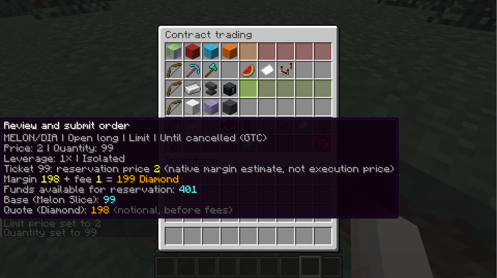
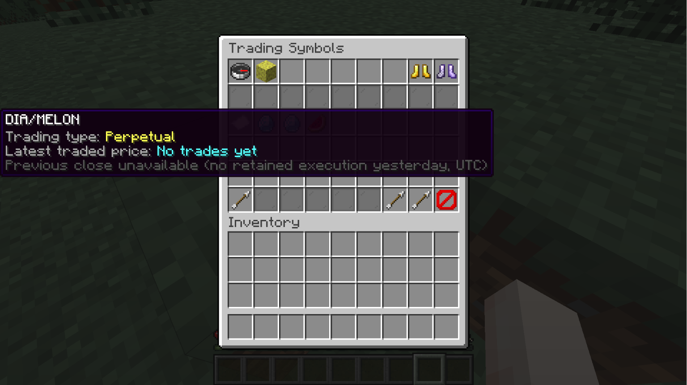
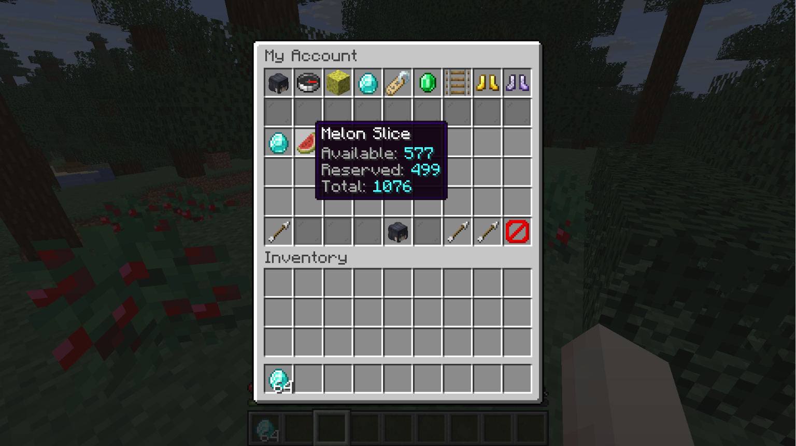
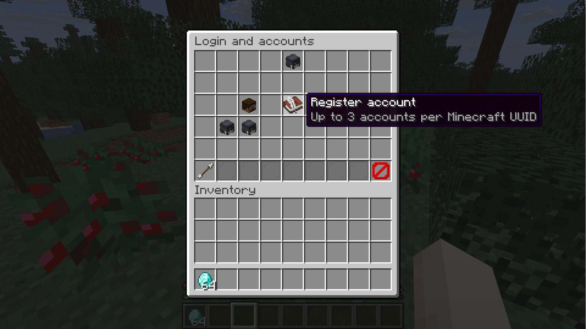
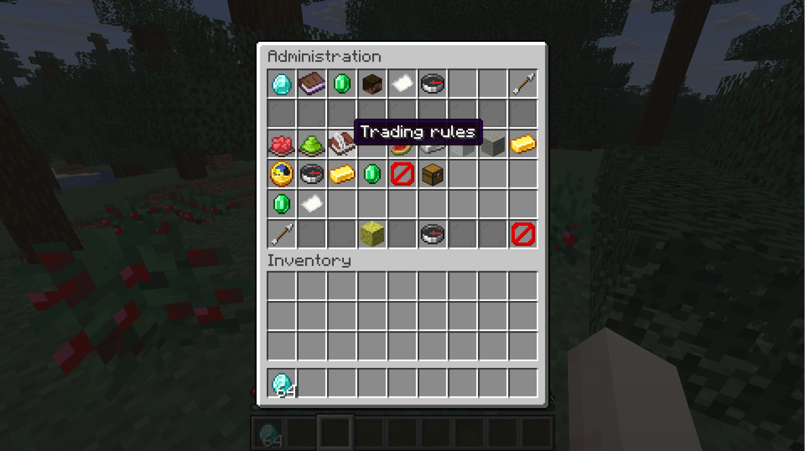
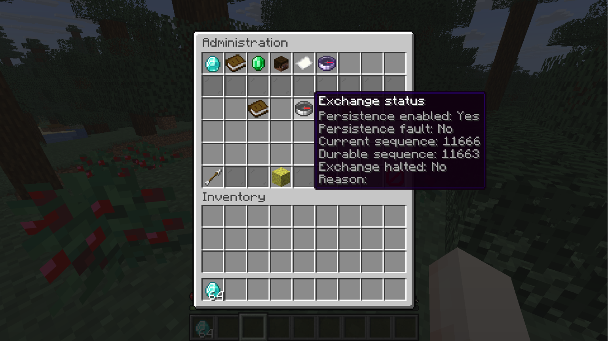

# CapitalMC

English · [简体中文](README.zh-CN.md)

A server-side Minecraft exchange powered by **AdvMatch 1.2.0**. Trade items and electronic assets through an inventory GUI. Players do not need a client mod.

## Features

- Separate trading accounts, with up to three accounts per Minecraft UUID.
- Spot, futures and perpetual trading; limit/market orders, take-profit/stop-loss, OCO, position details and margin controls.
- Live order books, search, price statistics and configurable depth.
- Batch item deposits, withdrawals, transfers and pegged currency exchange.
- Administrator tools for assets, markets, supply, fees, risk limits and recovery.
- English and Chinese UI, decimal input and private chat prompts.

## Install and build

Requires **Minecraft 26.3**, **Fabric Loader 0.19.5+**, **Fabric API for 26.3** and **JDK 25**.

```powershell
.\gradlew.bat build
```

Place `build/libs/CapitalMC-0.2.0-SNAPSHOT.jar` and Fabric API in the server's `mods` folder. SGui and AdvMatch are bundled. The included AdvMatch library targets **Windows amd64**; other platforms need a matching native SDK build.

For development, run `.\gradlew.bat runServer` and accept the Minecraft EULA before starting the server. The build runs unit tests and Minecraft GameTests.

## Get started

1. Run `/trade gui`, then register or log in to a trading account.
2. Deposit a registered asset, select a market and choose spot or contract trading.
3. Set the order details, review the summary and confirm in private chat.

Use `/cmcadmin gui` for administration; owner permission is required. A new server needs registered assets and configured markets before players can trade.

[Player and administrator guide](documentation/guide.en.md) · [中文使用说明](documentation/guide.zh-CN.md)

[Command reference](documentation/commands.en.md)

## Screenshots

| Contract trading | Trading symbols |
| --- | --- |
|  |  |

| Account balances | Login and accounts |
| --- | --- |
|  |  |

| Administration | Exchange status |
| --- | --- |
|  |  |

## Data and backups

AdvMatch owns the financial ledger; CapitalMC manages Minecraft identities and physical items. Back up the world, the exchange persistence directory and the entire `capitalmc` directory together while the server is stopped. Keep `services.json` with `services.json.wal`. Uncertain deliveries require review rather than automatic retry.
